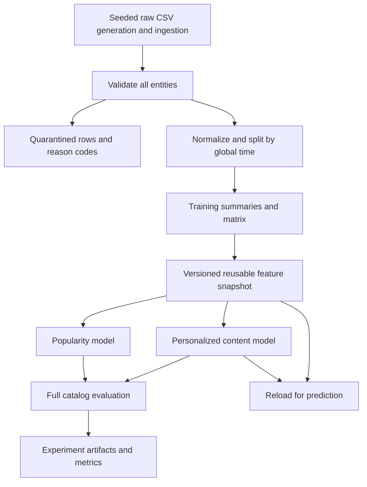

# Pipeline architecture

The workflow targets Python 3.14 with pandas 2.3.3.

`dags/workflow.py` enforces the ordered dependencies, fails immediately on errors,
and writes task status after each stage. GitHub Actions runs it weekly and on
manual dispatch. `experiments/<run_id>/` preserves parameters, metrics, feature
profiles, both models, environment versions and SHA256 input/source hashes.
